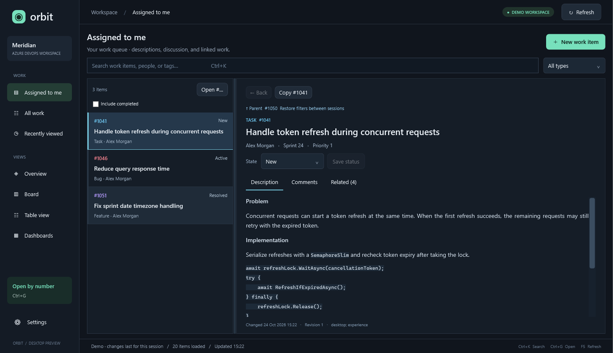

# Orbit

A native Windows work-item client for Azure DevOps, built with **WPF, .NET 10, and Telerik UI for WPF**. The first version opens into a populated demo so you can explore the experience before supplying credentials.



## Daily work

Orbit opens to **Assigned to me**, with an Outlook-style folder/list/reading-pane layout. Dashboards and statistics remain under Views.

- **Assigned to me** uses a separate server-side WIQL query with `System.AssignedTo = @Me`, so older assigned items are not lost behind the recent-project limit. The identity is the PAT owner. Completed items are hidden by default; use **Include completed** to show them. The configured item limit applies independently to this query.
- **All work** shows the recent project set in the same reading layout. **Recently viewed** keeps a connection-session navigation history, including related items outside the loaded queue.
- Select a row once, or use the arrow keys, to read the item. Drag the divider to resize the list and reading pane.
- **Description** renders native, selectable text with headings, lists, emphasis and code. Hover the content for a quiet pencil, double-click it, or focus it and press `F2`/`Enter` to edit inline. Azure DevOps HTML opens as a rendered Telerik `RadRichTextBox` document—HTML is never exposed in the normal UI—and common formatting is available visually. Markdown/plain-text descriptions remain Markdown/plain text. Acceptance criteria stays visibly separate because it is a separate API field. Saves use the work-item revision as a concurrency guard.
- **Comments** loads the actual Azure discussion, with author, timestamp, and explicit Load more paging. Comment pencils appear on hover/focus; double-click and `F2` also work. Legacy HTML comments edit visually, while Markdown comments remain portable Markdown. New comments are authored as Markdown. Azure DevOps applies its normal ownership and permission rules.
- **Related** shows parent, children, related items, predecessors/successors and duplicate links, including each readable item's title, type, status and assignee. Click to navigate; use **Back** to return. The parent is also available above the title. Inaccessible items remain listed by number.
- **Save status** writes a revision-checked state change. A failed save retains the draft. Board/table edits update the assigned list as well.
- **Open #…** / **Ctrl+G** reads any accessible work item by number, even if it is outside the current list. **Copy #** copies the number.

Description, relations, and discussion load on demand. Changing selection cancels pending reads and rejects stale responses; a failed comment or relation request does not hide the description. Relation responses never cause arbitrary URLs to receive the PAT: only same-organization work-item IDs are resolved using the client's configured API endpoint.

## Run it

Open `artifacts/Orbit/DevOpsClient.exe` after publishing, or use the lazy start script, which restores, builds, runs the contract checks, publishes, and launches the packaged app:

```powershell
.\Start-Orbit.ps1
```

Requirements: Windows 10/11, .NET 10 SDK to build, and .NET 10 Desktop Runtime to run the published app. Telerik WPF **2026.3.812** is pinned because it is covered by the local license checked during development. This build restored from NuGet.org and validated that license successfully. Other developers need their own valid Telerik developer/trial license; the license file is not included in this repository or the app distribution.

## Connect your project

Use **Connection settings → Save & connect**, or edit `appsettings.json` beside the executable and restart the app:

```json
{
  "ProjectUrl": "https://dev.azure.com/your-organization/your-project",
  "PersonalAccessToken": "your-pat",
  "Team": "",
  "UseDemoData": false,
  "MaxWorkItems": 500,
  "ThemeFamily": "Fluent",
  "Theme": "Dark",
  "FontFamily": "Segoe UI",
  "FontScale": 1.0
}
```

`appsettings.local.json`, if present, takes precedence over `appsettings.json`. The settings screen saves this local override atomically beside the executable. For source runs, settings are read from `src/DevOpsClient/bin/Debug/net10.0-windows/`; edit `src/DevOpsClient/appsettings.json` before building to change the shipped defaults. A rebuild preserves the local override. The folder must be writable when saving settings from the UI.

The Markdown reader is verified in the published desktop smoke test. The demo includes a Markdown discussion entry, so the native formatting can be inspected before connecting a project.

Use the **project URL**, without `_boards`, `_workitems`, or query parameters. Both `dev.azure.com/organization/project` and `organization.visualstudio.com/project` are supported. Spaces in project names work. Azure DevOps Server/on-premises URLs are outside this starter's scope.

PAT scopes:

- **Work Items: Read** to browse; **Read & write** to create and update.
- **Dashboard: Read** for dashboard discovery.

The PAT is masked in the UI but stored as **plain text**, as requested for file-based configuration. The local override and Telerik license files are ignored by Git. Never commit credentials to the tracked default settings file. The app sends credentials using Basic authentication over HTTPS, disables automatic redirects, and avoids displaying raw API error bodies or headers.

## What's working

- **Overview:** loaded work item counts, active work, open bugs, completion, category distribution, unassigned work, and recent changes. Metrics explicitly describe the loaded set, not the whole project or an inferred sprint.
- **Board:** native cards grouped by process state category, color-coded types, people, priorities, effort, tags, text/type/owner filtering, and drag-and-drop state changes. When a category has multiple possible states, the editor asks you to choose the exact state. Actual project workflow states come from Azure DevOps metadata.
- **Work items:** a real Telerik `RadGridView`, with column sorting and built-in column filters. Double-click or press Enter on a selected row to edit. Telerik `RadComboBox` controls are also used for filters, workflow state, priority, creation type, and appearance choices, so those keyboard and input behaviors come from the selected Telerik theme family.
- **Editor:** title, state, tags, priority, visual rich-text descriptions/legacy comments, Markdown descriptions/comments, acceptance criteria when exposed by the process, and comment create/edit workflows. Reading stays visually clean until hover, keyboard focus, double-click, or `F2` reveals editing. Work-item saves use a revision guard to prevent overwriting concurrent changes. Unsaved edits prompt before navigation, refresh, or closing.
- **Creation:** choose a project work item type and enter a title. Additional custom required fields must currently be supplied in Azure DevOps.
- **Dashboards:** discovers the configured team's dashboards (or project dashboards when Team is blank) and opens them in your browser. A dashboard permission failure does not prevent loading work items.
- **Settings:** masked token, URL validation, demo/live switching, optional team, bounded work item limit, and accessibility controls for Telerik theme families (Fluent, Windows 11, Material, and Office 2019), Dark/Light/High contrast color variations, font family, and reading size (80%–180%). Appearance changes are saved locally and applied to the workspace and Markdown reader.
- **Shortcuts:** Ctrl+K search, Ctrl+G open by number, Ctrl+N new item, F5 refresh, Escape close editor.
- **Demo:** create, edit, move, filter and refresh without credentials. Changes last for the current application session.

## Investigation and decisions

WPF fits a Windows-only client well: native input, desktop deployment, mature Telerik controls, and no embedded browser required for the primary work-item experience. Telerik's NoXaml implicit-style resource dictionaries are applied globally, with runtime family switching across Fluent, Windows 11, Material, and Office 2019 plus Dark/Light/High contrast color variations. This gives Telerik controls and the supported native WPF controls the same theme foundation and allows the palette to change at runtime. The work-item grid and key selectors use Telerik controls, while the surrounding Outlook-style shell remains intentionally lightweight WPF so the reading workflow stays familiar. The service layer is independent of the UI and can support a future MVVM presentation layer without changing the API contract.

Azure DevOps REST 7.1 supplies the core features directly:

| Feature | API / implementation |
| --- | --- |
| Query recent project work | WIQL POST with `@project` and a bounded `$top` |
| Load details | Work items batch POST, at most 200 IDs per request |
| Discover types and workflow states | Work item types; state endpoint fallback when metadata is missing |
| Create / edit | JSON Patch POST / PATCH; edits begin with a `/rev` test |
| Discover dashboards | Dashboard list, `7.1-preview.3`, optionally scoped to a team |

The overview is native. Existing Azure dashboard widgets are web extensions with their own rendering and permissions; this starter links to their original web dashboard. The board is a project work-item view grouped by state categories; it does not yet reproduce Azure team board columns, backlog levels, swimlanes, ordering, WIP limits, or sprint scoping. API workflow rules remain authoritative on save.

Only the most recently changed items are loaded (500 by default, configurable from 1–2000). Hitting the limit displays a notice. There is no background sync, local cache, offline edit queue, attachment handling, assignee editing, comment deletion, or automatic retry of writes. Telerik's HTML importer/exporter supports the common document structures used by Azure DevOps, but not arbitrary browser HTML; the original API value is left untouched until the user actually changes and saves it. New comments use Markdown. Authentication, permissions, throttling, timeouts and revision conflicts surface as actionable errors. A failed save retains the editor draft. F5 refreshes data; restart or use Settings to reload changed connection configuration.

Primary sources consulted:

- [Microsoft: WIQL @Me identity macro](https://learn.microsoft.com/en-us/azure/devops/boards/queries/wiql-syntax?view=azure-devops)
- [Microsoft: work item details and relationships](https://learn.microsoft.com/en-us/rest/api/azure/devops/wit/work-items/get-work-item?view=azure-devops-rest-7.1)
- [Microsoft: paged work item comments](https://learn.microsoft.com/en-us/rest/api/azure/devops/wit/comments/get-comments?view=azure-devops-rest-7.1)
- [Microsoft: add a Markdown work item comment](https://learn.microsoft.com/en-us/rest/api/azure/devops/wit/comments/add-work-item-comment?view=azure-devops-rest-7.1)
- [Microsoft: update a work item comment](https://learn.microsoft.com/en-us/rest/api/azure/devops/wit/comments/update-work-item-comment?view=azure-devops-rest-7.1)

- [Telerik WPF first steps and NuGet packages](https://www.telerik.com/products/wpf/documentation/getting-started/first-steps-nuget)
- [Telerik RadRichTextBox overview](https://www.telerik.com/products/wpf/documentation/controls/radrichtextbox/overview)
- [Telerik RadRichTextBox HTML support](https://www.telerik.com/products/wpf/documentation/controls/radrichtextbox/import-export/html/features-html-support)
- [Telerik WPF license installation](https://www.telerik.com/products/wpf/documentation/installation/licensing/installing-license-key)
- [Microsoft: WIQL](https://learn.microsoft.com/en-us/rest/api/azure/devops/wit/wiql?view=azure-devops-rest-7.1)
- [Microsoft: work item batch loading](https://learn.microsoft.com/en-us/rest/api/azure/devops/wit/work-items/get-work-items-batch?view=azure-devops-rest-7.1)
- [Microsoft: work item types](https://learn.microsoft.com/en-us/rest/api/azure/devops/wit/work-item-types/list?view=azure-devops-rest-7.1)
- [Microsoft: state categories](https://learn.microsoft.com/en-us/rest/api/azure/devops/wit/work-item-type-states/list?view=azure-devops-rest-7.1)
- [Microsoft: revision-checked work item updates](https://learn.microsoft.com/en-us/rest/api/azure/devops/wit/work-items/update?view=azure-devops-rest-7.1)
- [Microsoft: dashboard discovery](https://learn.microsoft.com/en-us/rest/api/azure/devops/dashboard/dashboards/list?view=azure-devops-rest-7.1)

## Build and verify

```powershell
dotnet restore DevOpsClient.sln --configfile NuGet.Config
dotnet build DevOpsClient.sln --no-restore
dotnet test DevOpsClient.sln --no-build --no-restore
.\Publish-Orbit.ps1
```

The structured xUnit suite (`tests/DevOpsClient.Core.Tests`) now covers settings defaults, URL validation, theme-family/font/scale validation, local appearance persistence, Azure REST contracts through focused handlers, and true loopback HTTP integration tests for authentication, URL routing, batching, paging, content types, revision bodies, description fields, Markdown comment creation/editing, relationship loading, cancellation, sanitized failures, demo mutations, and work-item edits. The integration server is local and never needs a PAT. The published desktop smoke test separately verifies native HTML sanitization, Markdown rendering and authoring, description/comment editors, Telerik selectors, all four runtime theme families, and the reading workflow. `Publish-Orbit.ps1` runs the full xUnit suite before packaging; run the smoke command below for desktop verification.

To render and smoke-test the native UI on Windows:

```powershell
$env:ORBIT_SMOKE_DIR = "$PWD\artifacts\screenshots"
& .\artifacts\Orbit\DevOpsClient.exe --smoke
```

Smoke mode **always uses demo data**, ignores live settings, renders the assigned-work reading pane, comments and relationship tabs plus the secondary views; exercises assigned-item filtering, comment paging, description editing, Markdown comment creation/editing, parent/child and Back navigation, the Open by number dialog, status changes, stale-response rejection, document sanitization, Markdown rendering, search/type/owner filters, creation, editor saves, refresh, and board state changes; captures compact layouts, writes `smoke.txt`, and exits. If it fails, the process exits nonzero and writes `smoke-error.txt` beside the executable. Live connectivity has not been exercised because no project URL or PAT was provided. The published client is ready for a live read-only test with **Work Items: Read**; use **Work Items: Read & write** to save fields or comments, and **Dashboard: Read** for dashboard discovery. Do not commit the local settings override.

## Layout

```text
src/DevOpsClient            WPF shell, native views, Telerik controls, configuration
src/DevOpsClient.Core       Models, settings, Azure REST client, demo service
tests/DevOpsClient.Core.Tests  Structured xUnit unit and service-contract tests
artifacts/Orbit             Published Windows desktop application (generated)
artifacts/screenshots       Native UI captures and smoke result (generated)
```

The next useful increment would be team/sprint selection with real Azure board configuration, followed by encrypted credentials, a cached read-only workspace, and richer work-item fields.


